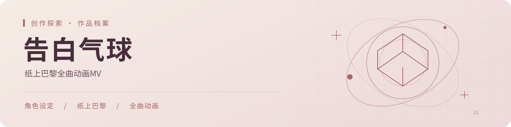
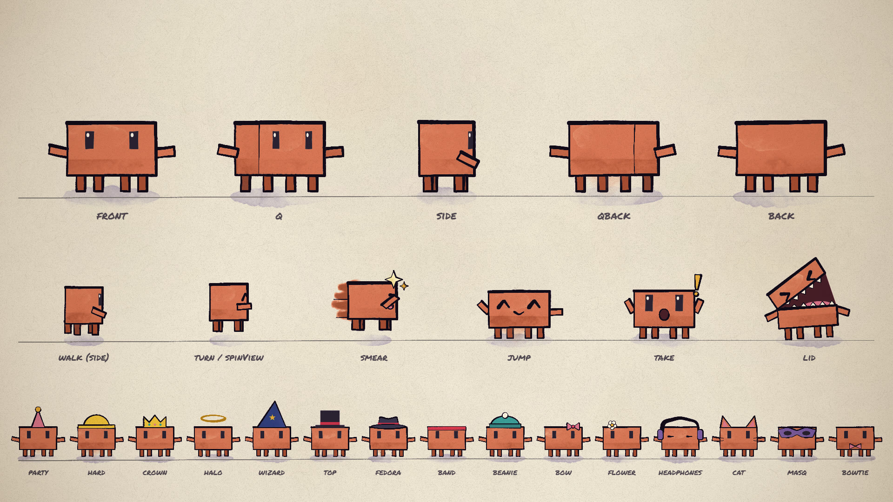
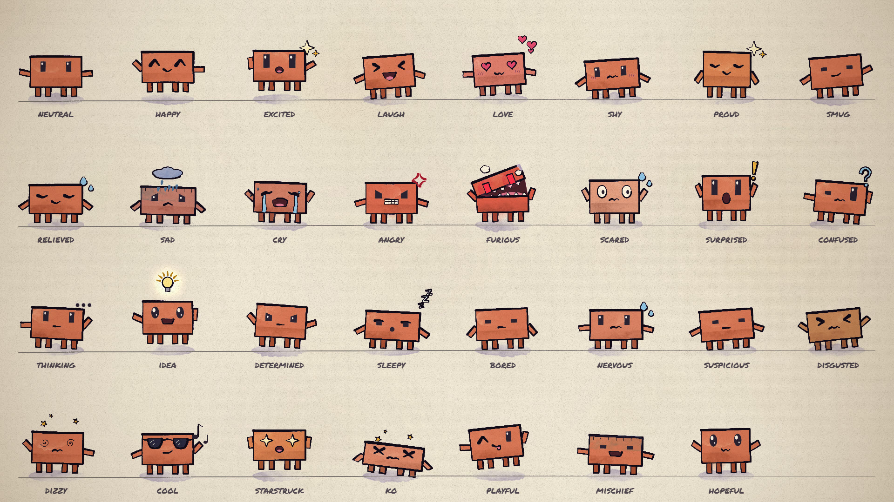

<!-- project-showcase:start -->

<b>角色设定 · 纸上巴黎 · 全曲动画</b>

<a href="#作品画面">看作品</a>　 ·　 <a href="ITERATION_HISTORY.md">历次迭代</a>　 ·　 <a href="https://github.com/qiuyimei/love-balloon-animation/archive/refs/heads/main.zip">下载源码</a>　 ·　 <a href="https://github.com/qiuyimei/codex-old-deliverables-20261031#作品图录">全部作品</a>

**告白气球** · 纸上巴黎全曲动画MV。

## 作品画面

<table><tr><td width="50%" align="center" valign="top"> 角色多视图设定</td><td width="50%" align="center" valign="top"> 角色表情设定</td></tr></table>

## 从这里开始

| 想做什么 | 入口 |
| --- | --- |
| 查看每次迭代、日期与改动 | [历史版本目录](ITERATION_HISTORY.md) |
| 下载当前完整源码 | [当前版本 ZIP](https://github.com/qiuyimei/love-balloon-animation/archive/refs/heads/main.zip) |
| 浏览当前工程 | [仓库文件](.) |

<!-- final-delivery:20261111 -->

> **最终完整版资料：** [完整工程、详细文档与影片](https://github.com/qiuyimei/love-balloon-animation/releases/tag/final-delivery-20261111)

<!-- project-showcase:end -->

---

## 使用与项目说明

这里保存全曲动画源码及角色设定资料。角色多视图与表情图见上方；源码的恢复快照、浏览入口与整版 ZIP 下载见[历史版本目录](ITERATION_HISTORY.md)。
